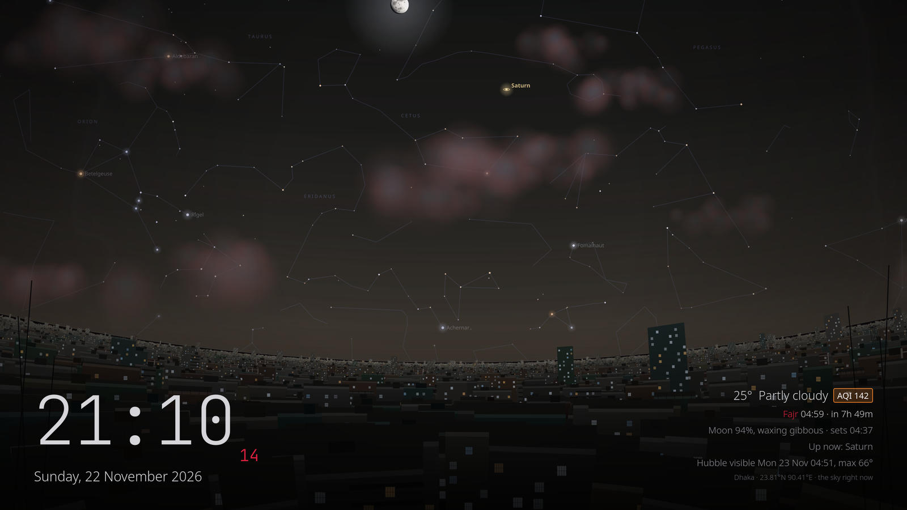
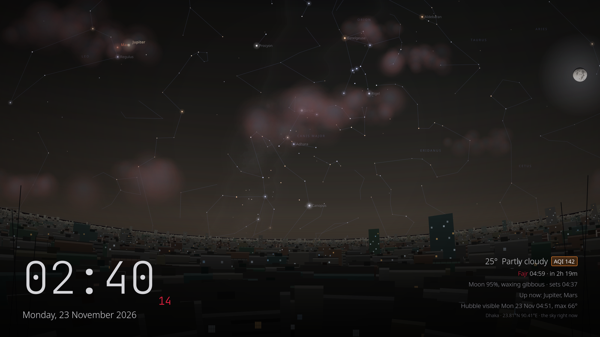

# Live Sky



A KDE Plasma 6 wallpaper of the real sky over you, right now, made for the lock screen: the view from a rooftop, through a wide fisheye lens (a stereographic projection, so constellations keep their shapes), looking across and down over the city.

What's in it:
- **Stars** to magnitude 5.5, coloured by temperature, with constellation figures and names
- **The Milky Way**, in five brightness levels
- **The planets**, the **Moon** (real phase, tilt, maria and earthshine, drawn larger than life so its face reads) and the **Sun**
- **Light:** the sky colour follows the Sun through day, twilight and night, with a sunset glow and a warm city skyglow along the horizon. A bright Moon washes out the Milky Way and the faintest stars, as it does outside.
- **Satellites:** the ~150 brightest move across it live whenever they're sunlit in a dark sky. When the ISS, Tiangong or Hubble has a visible pass coming up, its track is drawn in.
- **Meteors:** now and then one streaks across, a few an hour. Around a major shower's peak they come faster and fly away from the shower's radiant.
- **The city from above:** rows of buildings from ~25 m out to ~3 km, placed by real perspective from your eye height (about 31 m: an 8th floor over lower blocks). Roofs lower than your eye sit below the horizon, so you look down on the near blocks' flat roofs (water tanks, stair huts, rebar) and only the tall ones break the skyline. Facades come in Dhaka's colours: exposed brick in concrete frames, peach, cream, teal, green, white striped towers. Close windows have frames and grilles; the haze swallows the distance; windows light up in the evening and go dark one by one through the night. Rebar and bamboo poles rise from your own roof in the corners.
- **Lit by the real Sun and Moon:** a bright Moon high up silvers the roofs and facades with a cool light, more on the faces turned towards it, while a thin or set Moon (or thick cloud) leaves the city dark. With the Sun low, the facades facing it glow warm, and the city fades into night through twilight. It all follows the sky as it moves.
- **The real weather:** clouds from the live cloud cover, drifting the way the wind actually blows, lit orange by the city at night and pink at sunset; haze along the horizon from the live PM2.5 (a bad-air night looks it); fog; rain when it's raining.
- **Real aircraft:** live positions from the OpenSky Network, flown on every frame between reports by dead reckoning, along arcs at the turn rate seen between reports, with each new report's correction eased in over a few seconds. They're drawn at their true angular size (side-on when low, from below when high), with the navigation light on your side, a red beacon, white double strobes, landing lights that blaze only when the aircraft points at you, and callsign and height. Only traffic at or below 1,000 m is shown (the arrivals and departures you can hear); it fades in as it descends through that height.
- **Little life:** the brightest stars twinkle, harder near the horizon, and at dawn and dusk a flock of birds sometimes crosses.
- **A big clock and the date** in the lower left. In the lower right: weather and air quality, the next prayer time, the Moon, the planets that are up, and the next visible satellite pass.




## Install

```sh
./install.sh
```

This installs the wallpaper and makes it the lock screen's wallpaper. It also hides the stock lock-screen clock, which would duplicate this one; the password prompt still fades in as usual when you move the mouse. Preview it without locking with `/usr/lib/kscreenlocker_greet --testing`. `./uninstall.sh` puts the lock screen back as it was (from `~/.config/kscreenlockerrc.before-livesky`).

The lock screen has no network access, by design. So `install.sh` also sets up `livesky-fetch`, a systemd user timer that runs every 30 minutes. It writes the current weather and air quality (Open-Meteo) and the satellite orbits (CelesTrak, at most every 6 hours, cached in `~/.cache/livesky`) into the lock screen's wallpaper settings. As a desktop wallpaper, it fetches for itself.

Aircraft come from `livesky-planes`, a small user service that polls the [OpenSky Network](https://opensky-network.org) **only while the screen is locked**, once a minute, and writes `~/.cache/livesky/planes.qml` for the lock screen to reload (local files are the one thing it can read). OpenSky allows 400 anonymous requests a day, enough for six or seven hours of locked screen; the service watches the remaining budget, slows down as it runs low, and backs off when told to. It polls every 20 s while something is airborne and low within 15 km, and every 75 s otherwise. It sends only a box around your location rounded to 0.1°. Coverage depends on volunteer ADS-B receivers; around Dhaka it picks up traffic in and out of Shahjalal.

Settings (System Settings → Screen Locking → Appearance → wallpaper settings): place and coordinates, which way the view faces and how wide it is, how many stars (city, suburban, dark site), labels, meteors, clock, 24-hour time, and the read-out.

### Placing your own buildings

The `landmarks` key in `[Greeter][Wallpaper][com.github.sarwaruddin.livesky][General]` of `kscreenlockerrc` takes a JSON list of things to place by hand on top of the generated city. Buildings take a compass bearing, distance and size in metres, a colour index (0 cream, 1 white, 2 light grey, 3 grey, 4 brick, 5 peach, 6 teal, 7 green, 8 yellow) and a `kind`:
- `block`, `striped` (a white high-rise with balcony bands), `antennas` (a rooftop telecom array)
- `led` (outlined in warm LED strips; an optional `label` glows on top), `office` (every floor lit), `dome` (a lit glass dome rising out of its base)

Two more kinds shape the ground: `green` clears a sector (`az1`..`az2`, `dmin`..`dmax` metres) of buildings and plants it with trees, and `road` lines a straight road (`from` and `to`, each `{az, dist}`) with street lamps and a little traffic.

```json
[
 {"az":200,"dist":120,"width":22,"height":40,"kind":"striped","color":1},
 {"az":140,"dist":400,"width":40,"height":18,"kind":"dome"},
 {"az":150,"dist":800,"width":40,"height":70,"kind":"led"},
 {"kind":"green","az1":100,"az2":115,"dmin":800,"dmax":2500},
 {"kind":"road","from":{"az":112,"dist":900},"to":{"az":100,"dist":2500}}
]
```

## Accuracy and credits

Planets use JPL's approximate Keplerian elements; the Moon uses Meeus ch. 47 with topocentric parallax; satellites use SGP4 (Vallado 2006), checked against the reference implementation and Skyfield. All of it is shared with the Cosmic Observatory widget. Prayer times use the praytimes.org formulas (Karachi, Hanafi by default).

Star, constellation and Milky Way data come from [d3-celestial](https://github.com/ofrohn/d3-celestial) v0.7.32 (BSD-3-Clause, Copyright (c) 2015 Olaf Frohn; star positions from Hipparcos); its license is in `package/contents/code/catalog.LICENSE`. `tools/` regenerates the data files.

`lib/calendar.js` (Bangla calendar, and Hijri dates by Yallop crescent visibility) isn't used here; it's kept for a future clock widget.
